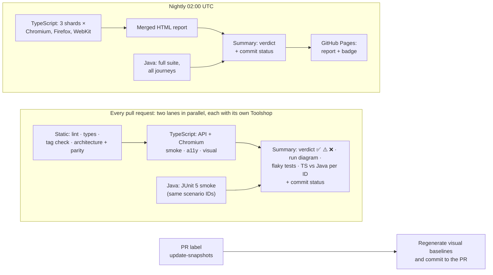
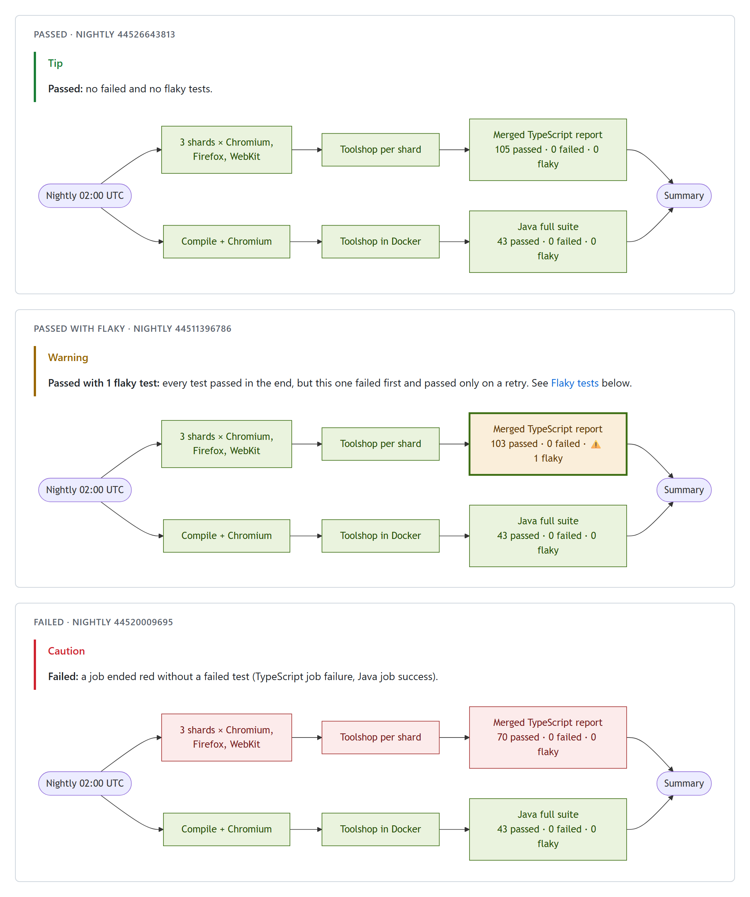

# Playwright E2E Showcase

[](https://github.com/junchunip-hue/playwright-e2e-showcase/actions/workflows/pr-smoke.yml)
[](https://junchunip-hue.github.io/playwright-e2e-showcase/)

A test automation framework built the way I would set it up in a real team, with **Playwright + TypeScript**
and the same scenarios in **Java + JUnit 5**. It targets the open-source [Toolshop](https://practicesoftwaretesting.com)
demo shop.

**At a glance:** 69 TypeScript test cases, run 107 times a night across Chromium, Firefox and WebKit · 44 Java tests ·
every API, UI and journey ID in both languages · one verdict per run: ✅ passed, ⚠️ passed with flaky, ❌ failed.
The "nightly tests" badge above is the latest nightly's count, coloured like its verdict; click it for that run's HTML report.

<p align="center">
  
  <br><sub>U6 as the test drives it, from the screencast of a real run's Playwright trace (Chromium, about 5 seconds).</sub>
</p>

**Status:** every P1/P2 risk covered and every demo technique shown ([definition of done](docs/roadmap.md#5-definition-of-done)).
Stability is being re-earned: a flaky S2 on 2026-11-19 (a test race, fixed in [#27](https://github.com/junchunip-hue/playwright-e2e-showcase/pull/27)) reopened the "five clean nightlies
in a row" criterion, 2 of 5 so far. Next steps are in the [roadmap](docs/roadmap.md#6-what-comes-next). Test IDs (A = API, U = UI, S = journey, N = non-functional) and why
some numbers are missing are explained in the [test plan](docs/test-plan.md#how-ids-work).

## The 3-minute tour

**1. A journey that reads like the story it tests:** [`tests/e2e/checkout.spec.ts`](tests/e2e/checkout.spec.ts)
```ts
const customer = await createCustomer(api);              // arrange via API: fresh data, no shared state
const product = await api.products.findInStock();

await checkout.addToCart(product);                       // act via UI: business steps from src/flows
const cartTotal = await checkout.reviewCart([product]);
await checkout.signIn(customer);
await checkout.confirmSavedAddress(customer.address);    // the app fills in and looks up the saved address
const invoiceNumber = await checkout.pay(payments.cashOnDelivery());
// assert via API: the invoice exists, for this customer, at the cart total
```

**2. Quality beyond "it works"**
- Every API response is checked against a schema ([`src/api/schemas.ts`](src/api/schemas.ts)).
- Accessibility (axe, WCAG 2.1 AA) and visual regression run in [`tests/quality/`](tests/quality/).
- Network mocking shows what a customer sees when the backend is slow or fails ([`resilience.spec.ts`](tests/e2e/resilience.spec.ts)).
- Defects the tests found are tracked as tests: green while the defect exists, red once it is fixed
  ([`permissions.api.spec.ts`](tests/api/permissions.api.spec.ts), [ADR 0010](docs/decisions/0010-known-defects-as-tests.md)).
- The full suite runs nightly on Chromium, Firefox and WebKit.

**3. A pipeline that guards itself**
- Tags and suites live in one registry ([`src/tags.ts`](src/tags.ts)), and every test title carries its test-plan ID.
- [Architecture tests](tests/architecture/) fail if a workflow could trigger itself, a dependency loops, or a job could hang.
- Every scenario runs in a TypeScript lane and a Java lane. A summary on each CI run compares them per test ID and lists
  the known defects (see "How it runs").
- Flaky is visible, never silent: both lanes retry a failed test twice in CI, and a test that passed only on a retry
  turns the verdict gold (⚠️ passed with flaky) and is listed by name with its first error, as an annotation and in the
  commit status ([ADR 0011](docs/decisions/0011-retries-and-flaky-tests.md)).
- Browser installs are bounded, retried on other mirrors and served from a package cache, so a slow Ubuntu mirror
  cannot stall a run ([ci.md](docs/ci.md#workflows)).

## How it runs



Every run ends with a summary on its Actions page: one verdict, the run as a diagram, every flaky test by name, and
TypeScript vs Java per test ID. The verdict is also posted as a commit status (`test verdict / nightly`).

<p align="center">
  
  <br><sub>Nightly 44511396786, rendered from its results by the same summary script (top part): it passed, but S2
  failed once on Firefox and passed on the retry, so the verdict is gold and the test is listed with its first error.
  That flake was a test race, fixed in <a href="https://github.com/junchunip-hue/playwright-e2e-showcase/pull/27">#27</a>.</sub>
</p>

<details>
<summary>The three verdicts, from three real nightlies</summary>
<p align="center"></p>
<sub>Rendered from each run's results by the same summary script. Passed: 44526643813. Passed with flaky: 44511396786.
Failed: 44520009695, where one shard could not reach any Ubuntu mirror to install its browsers, so no test failed but
the TypeScript lane did. That run itself still said "Passed": it exposed the bug fixed in
<a href="https://github.com/junchunip-hue/playwright-e2e-showcase/pull/28">#28</a>, and is shown here as scored since.</sub>
</details>

| Layer | IDs | What it proves | Languages |
|---|---|---|---|
| API | A0–A11 | Contracts, auth, registration rules, invoice access, catalogue filters, payment check, admin publishing; customer-vs-admin permissions as tracked known defects | TS + Java |
| UI | U1–U5 | Login, search (incl. UI = API), cart | TS + Java |
| Journeys | U6/S1, S2–S6 | First purchase, every payment method, admin → customer → admin, guest checkout, returning customer with invoice download, slow or failing backend (network mocking) | TS + Java |
| Quality | N1, N2 | Visual regression, accessibility (WCAG 2.1 AA) | TS |
| Architecture | N3 | Pipeline cannot loop or hang (bounded, cached browser installs), TS/Java parity, equal CI retries | TS |

Full inventory, with where each ID runs: [docs/test-plan.md](docs/test-plan.md#3-test-inventory).

CI never uses the public demo: it boots its own Toolshop for every run, so results depend only on the code
([why](docs/ci.md#system-under-test)).

## Layout

```
src/
  api/          API client per resource + zod schemas (types derived from them)
  flows/        business steps for journeys (checkout, ...)
  pages/        page & component objects (locators only)
  data/         test data builders (fresh customers per test)
  fixtures/     everything above, injected into tests
  tags.ts       tag and suite registry
  known-defects.ts  tracked product defects (ADR 0010)
  a11y/ visual/ reporters/ config/
tests/
  api/          contracts, auth, registration, invoices, filters, payments, admin and permissions
  ui/           single-page behaviour (login, search, cart)
  e2e/          journeys across pages, API and UI (checkout, payments, admin, guest, returning customer, resilience)
  quality/      accessibility and visual regression
  architecture/ rules about the pipeline and the code itself
java/           Playwright for Java + JUnit 5: every A/U/S scenario, same IDs and tiers
scripts/        suite runner, bounded browser install and the CI pipeline summary
docs/           strategy, test plan, CI, Java, roadmap, decisions (ADRs)
.github/        workflows (PR, nightly, baselines) and shared actions
```

## Run it

```bash
npm install && npx playwright install && cp .env.example .env
npm run test:pr             # what the PR gate runs (API + Chromium)
npm run test:architecture   # pipeline/code rules, no browser
npm run check:tags          # tag counts; fails on unknown tags, missing tier or ID
npm test                    # everything (Chromium locally; ALL_BROWSERS=1 adds Firefox and WebKit)
npm run report              # open the HTML report
```
Locally the tests run against the public demo, which other people use too:
- **`@admin` tests are skipped** there: they change catalogue or orders, so they run against our own Toolshop only (CI).
- **Visual baselines are per OS and stay local:** CI compares the committed Linux ones. Your first run creates baselines
  for your OS, and the demo's shared data (e.g. new brands in the filter list) can make them stale later. Refresh them
  with `npx playwright test tests/quality/visual.spec.ts --update-snapshots`
  ([why](docs/decisions/0004-visual-baselines-from-ci.md)).
Java: `cd java && ./mvnw test` (JDK 21+, see [docs/java.md](docs/java.md)). Every scenario exists in both languages,
and each CI run ends with a summary that draws the run and compares TypeScript and Java per test ID.

## Read more

| Question | Document |
|---|---|
| Why is it built this way? | [docs/test-strategy.md](docs/test-strategy.md) |
| What runs, where, and which IDs exist? | [docs/test-plan.md](docs/test-plan.md) |
| How does the pipeline work and protect itself? | [docs/ci.md](docs/ci.md) |
| Which decisions were made, and why? | [docs/decisions/](docs/decisions/) |
| Where do I see the latest results? | [Nightly report](https://junchunip-hue.github.io/playwright-e2e-showcase/) (3 browsers) · each run's summary in [Actions](https://github.com/junchunip-hue/playwright-e2e-showcase/actions): run diagram + TS vs Java per ID ([how](docs/ci.md#pipeline-summary)) |
| What comes next? | [docs/roadmap.md §6](docs/roadmap.md#6-what-comes-next): keep it green, optional S7, ranked candidates, backlog |
| How do the TypeScript and Java lanes stay in sync? | [docs/java.md](docs/java.md) |

## License

[MIT](LICENSE) for the code in this repository. Toolshop, the application under test, is
[testsmith-io/practice-software-testing](https://github.com/testsmith-io/practice-software-testing) under its own
license; the GIF and summary images show its UI and results from runs against it.
