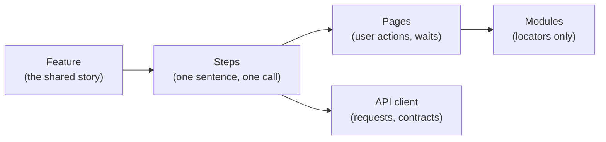
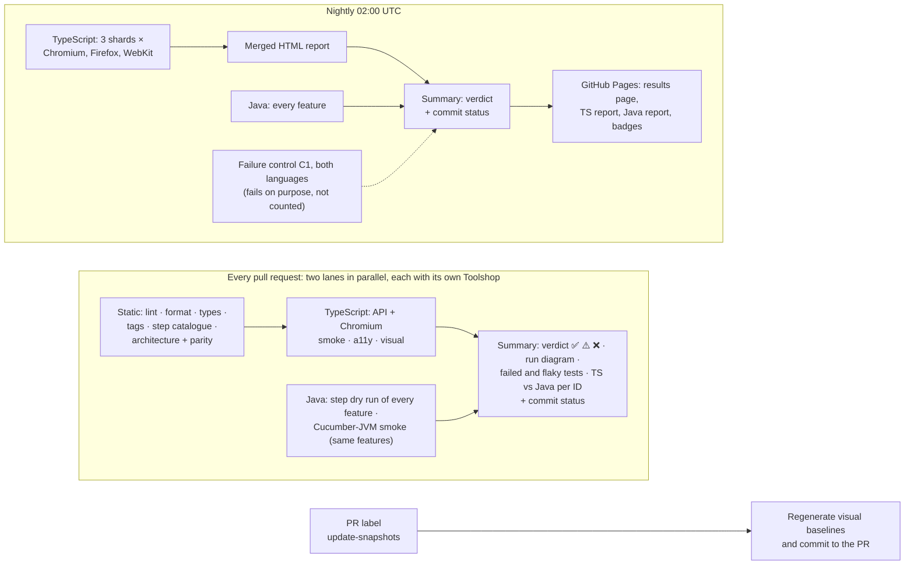
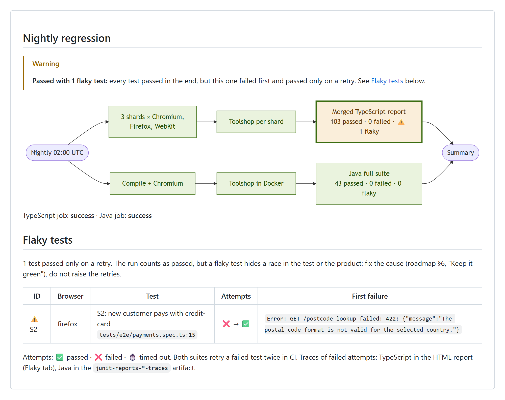

# Playwright E2E Showcase

[](https://github.com/junchunip-hue/playwright-e2e-showcase/actions/workflows/pr-smoke.yml)
[](https://junchunip-hue.github.io/playwright-e2e-showcase/)
[](https://junchunip-hue.github.io/playwright-e2e-showcase/#history)

A test automation framework built the way I would set it up in a real team. Every scenario is written **once, as a
Gherkin feature**, and run by two suites: **Playwright + TypeScript** (playwright-bdd) and **Playwright for Java**
(Cucumber-JVM on JUnit 5). It targets the open-source [Toolshop](https://practicesoftwaretesting.com) demo shop.

**At a glance:** 34 feature scenarios (41 test cases with Scenario Outline examples, plus the failure control C1)
run in both languages · 72 TypeScript test cases including quality and architecture checks: 110 runs a night across
Chromium, Firefox and WebKit (108 test runs + 2 sign-in setups, one per shard with browser tests) · one verdict per
run: ✅ passed, ⚠️ passed with flaky (or only on a rerun), ❌ failed.

The "nightly tests" badge above is the latest nightly's count of runs in both languages (110 TypeScript, including the
sign-in setups, + 41 Java = 151), coloured like its verdict. On top of that runs the failure control C1, which fails on
purpose and is never counted: the TypeScript and the Java report each list it as their one failed test, and the results
page shows it right below the two lanes. Both badges open the nightly's results page: the verdict, the count split by
language with the TypeScript report and the Java report (both Playwright HTML reports, in the same format), the
failure control, TypeScript vs Java per test ID, and the history.

<p align="center">
  
  <br><sub>U6 as the test drives it, from the screencast of a real run's Playwright trace (Chromium, about 5 seconds).</sub>
</p>

**Status:** done by its own [definition](docs/roadmap.md#5-definition-of-done): every P1/P2 risk covered, every demo
technique shown, five clean nightlies in a row in both languages. A flaky S2 on 2026-11-19 (a test race, fixed in
[#27](https://github.com/junchunip-hue/playwright-e2e-showcase/pull/27)) reset that count the same day it was first
met; it was earned again with nightlies #40–#53. Since then every scenario moved to shared Gherkin features
([ADR 0012](docs/decisions/0012-gherkin-features-with-layered-steps.md)), with a clean nightly after each step. The
"clean nightlies" badge above keeps counting after every nightly (the runs are in its `history.json`). Next steps are
in the [roadmap](docs/roadmap.md#6-what-comes-next). Test IDs (A = API, U = UI, S = journey, N = non-functional, C = control) and
why some numbers are missing are explained in the [test plan](docs/test-plan.md#how-ids-work).

## The 3-minute tour

**1. A journey that reads like the story it tests:** [`features/journeys/checkout.feature`](features/journeys/checkout.feature),
one file that both the TypeScript and the Java suite run
```gherkin
Scenario: U6: new customer buys an in-stock product with cash on delivery
  Given a newly registered customer                  # arrange via API: fresh data, no shared state
  And a product that is in stock
  When I open that product's page                    # act via UI; each sentence names the page it acts on
  And I add it to the cart on the product page
  Then the cart badge shows 1
  When I review the cart
  And I sign in as that customer at the checkout's sign-in step
  And I confirm my saved billing address             # the app fills in and looks up the saved address
  And I pay with "cash-on-delivery"
  Then that customer's invoice exists at the cart total   # assert via API
```

**2. Each sentence goes down the same layers in both languages**
([ADR 0012](docs/decisions/0012-gherkin-features-with-layered-steps.md)); an architecture test keeps every layer to its job.


Folders, TypeScript · Java: `features/` (shared) → `src/steps` · `steps/` → `src/pages` · `pages/` and `src/api` · `api/`
→ `src/modules` · `modules/` (Java under `java/src/test/java/com/showcase/`).

| Layer | `I pay with "cash-on-delivery"` in TypeScript | … and in Java |
|---|---|---|
| Step | [`checkout.steps.ts`](src/steps/checkout.steps.ts): `ctx.invoiceNumber = await checkoutPage.pay(paymentFor(method))` | [`CheckoutSteps.java`](java/src/test/java/com/showcase/steps/CheckoutSteps.java): `ctx.invoiceNumber = checkoutPage().pay(Payments.forMethod(method))` |
| Page | [`checkout.page.ts`](src/pages/checkout.page.ts) `pay()`: enter details, payment check, place the order, wait for `POST /invoices` | [`CheckoutPage.java`](java/src/test/java/com/showcase/pages/CheckoutPage.java) `pay()`: the same sequence |
| Module | [`checkout.module.ts`](src/modules/checkout.module.ts): `finish`, `paymentSuccess`, `orderConfirmation` | [`CheckoutModule.java`](java/src/test/java/com/showcase/modules/CheckoutModule.java): the same locators |

API scenarios read the same way; the API client stands in for the page
([`features/api/`](features/api/), steps in [`src/steps/api/`](src/steps/api/)).

**3. Quality beyond "it works"**
- Every API response is checked against a schema ([`src/api/schemas.ts`](src/api/schemas.ts), Java: [`Contracts.java`](java/src/test/java/com/showcase/api/Contracts.java)).
- A failing test stays a failure: no "known issue" markers, no expected failures. A failed scenario shows, in every
  report, the steps that passed, the one step that failed, and each step after it as not run (TypeScript report,
  Java report, run summary and results page). The fix goes into the test or the product until everything passes
  ([ADR 0013](docs/decisions/0013-failures-stay-failures.md)). To show what that looks like, the nightly also runs
  one failure control, C1 ([`failure-control.feature`](features/control/failure-control.feature)): it fails on purpose
  at step 2 of 4 in both languages, with steps 3 and 4 listed as not run, appears in the reports as a real failure, and
  is left out of the verdict, the counts and the badge
  ([results page, "Failure control"](https://junchunip-hue.github.io/playwright-e2e-showcase/#control)).
- Network mocking shows what a customer sees when the backend is slow or fails ([`resilience.feature`](features/journeys/resilience.feature), mocking in [`network.page.ts`](src/pages/network.page.ts)).
- Accessibility (axe, WCAG 2.1 AA) and visual regression run in [`tests/quality/`](tests/quality/).
- The full suite runs nightly on Chromium, Firefox and WebKit.

**4. A pipeline that guards itself**
- Tags and suites live in one registry ([`src/tags.ts`](src/tags.ts)); Gherkin tags are the tiers, and every scenario
  title carries its test-plan ID, checked by `npm run check:tags` for both languages at once.
- [Architecture tests](tests/architecture/) fail if a workflow could trigger itself, a dependency loops, a job could
  hang, a step creates a locator, or the test plan and the two languages disagree.
- One code style for everyone, applied by tools, not by review: Spotless (Java) and Prettier with ESLint's import order
  (TypeScript, Gherkin). `npm run format` fixes it all; a pre-push hook and the PR gate check it
  ([coding rules](docs/coding-rules.md)).
- One sentence per action: the [step catalogue](docs/steps.md) lists every step by the page it acts on, generated from
  the code; the PR fails if it is stale, a step is unused or exists in one language only.
- Every scenario runs in a TypeScript lane and a Java lane. A missing step fails the PR in either language: `bddgen` for
  TypeScript, a Cucumber dry run over every feature for Java. A summary on each CI run compares the lanes per test ID
  and lists every failed test with its failed and not-run steps (see "How it runs").
- Flaky is visible, never silent: both lanes retry a failed test twice in CI, and a test that passed only on a retry
  turns the verdict gold (⚠️ passed with flaky) and is listed by name with its first error, as an annotation and in the
  commit status ([ADR 0011](docs/decisions/0011-retries-and-flaky-tests.md)).
- Browser installs are bounded, retried on other mirrors and served from a package cache, so a slow Ubuntu mirror
  cannot stall a run ([ci.md](docs/ci.md#workflows)).

## How it runs



Every run ends with a summary on its Actions page: one verdict, the run as a diagram, every failed test with the step
where it failed and the steps that did not run, every flaky test by name, TypeScript vs Java per test ID, and the failure
control C1 (not counted). The verdict is also posted as a commit status (`test verdict / nightly`), and the
nightly's lands on its [results page](https://junchunip-hue.github.io/playwright-e2e-showcase/) with both reports and
the history.

<p align="center">
  
  <br><sub>Nightly 44511396786, rendered from its results by the same summary script (top part): it passed, but S2
  failed once on Firefox and passed on the retry, so the verdict is gold and the test is listed with its first error.
  That flake was a test race, fixed in <a href="https://github.com/junchunip-hue/playwright-e2e-showcase/pull/27">#27</a>.
  The run predates the Gherkin features: S2 lived in <code>tests/e2e/payments.spec.ts</code> then and is now in
  <code>features/journeys/checkout.feature</code>.</sub>
</p>

<details>
<summary>The three verdicts, from three real nightlies</summary>
<p align="center"></p>
<sub>Rendered from each run's results by the same summary script. Passed: 44526643813. Passed with flaky: 44511396786.
Failed: 44520009695, where one shard could not reach any Ubuntu mirror to install its browsers, so no test failed but
the TypeScript lane did. That run itself still said "Passed": it exposed the bug fixed in
<a href="https://github.com/junchunip-hue/playwright-e2e-showcase/pull/28">#28</a>, and is shown here as scored since.</sub>
</details>

| Layer | IDs | What it proves | Where |
|---|---|---|---|
| API | A0–A9 | Contracts, auth, registration rules, invoice access, catalogue filters, payment check, admin publishing (A10/A11 removed: [test plan](docs/test-plan.md#findings)) | [`features/api`](features/api/), TS + Java |
| UI | U1–U5 | Login, search (incl. UI = API), cart | [`features/ui`](features/ui/), TS + Java |
| Journeys | U6 (S1), S2–S6 | First purchase, every payment method, admin → customer → admin, guest checkout, returning customer with invoice download, slow or failing backend (network mocking) | [`features/journeys`](features/journeys/), TS + Java |
| Quality | N1, N2 | Visual regression, accessibility (WCAG 2.1 AA) | [`tests/quality`](tests/quality/), TS |
| Architecture | N3 | Pipeline cannot loop or hang (bounded, cached browser installs), layer rules, TS/Java parity, equal CI retries | [`tests/architecture`](tests/architecture/), TS |
| Control | C1 | Not a product test: fails on purpose every night to show how a failure is reported; never counted | [`features/control`](features/control/), TS + Java |

Full inventory, with where each ID runs: [docs/test-plan.md](docs/test-plan.md#3-test-inventory).

CI never uses the public demo: it boots its own Toolshop for every run, so results depend only on the code
([why](docs/ci.md#system-under-test)).

## Layout

```
features/       the scenarios, shared by both languages (ADR 0012): api/ (A0–A9), ui/ (U1–U5), journeys/ (U6 = S1, S2–S6),
                control/ (C1: fails on purpose, outside the verdict)
src/
  steps/        Gherkin bindings: one sentence → one page method (playwright-bdd); api/ calls the API client;
                hooks that list not-run steps after a failure and label the failure control
  pages/        what a user does on a page (*.page.ts), built on its module; network.page.ts mocks the backend (S6)
  modules/      locators only (*.module.ts)
  api/          API client per resource + zod schemas (types derived from them)
  data/         test data builders (fresh customers per test)
  fixtures/     pages, API client and the scenario context, injected into steps and specs; not-run.ts lists the
                steps after a failed one at the same level
  tags.ts       tag and suite registry
  a11y/ visual/ reporters/ config/
tests/
  quality/      accessibility and visual regression (N1, N2)
  architecture/ rules about the pipeline and the code itself (N3)
  auth.setup.ts the sign-in setup: signs the demo customer in once per shard with browser tests
  ui/           the Playwright Test Agents' seed
  features/     generated from features/ by `npx bddgen` (git-ignored)
java/           the same features in Java: RunCucumberTest + steps/ → pages/ → modules/, api/, data/; report/ScenarioLog
                logs every scenario attempt with its steps, hooks and errors for the summary and the Java report
scripts/        suite runner, demo, formatter (format.mjs), step catalogue (step-catalog.mjs), bounded browser
                install, the CI pipeline summary, the Java report (java-report.mjs), and the nightly's history and
                results page on GitHub Pages
.claude/agents/ Playwright Test Agents (planner, generator, healer) with .mcp.json: an exploration aid; plans land in
                specs/ and become features, never committed generated specs (see specs/README.md)
docs/           strategy, test plan, coding rules, step catalogue (steps.md), CI, Java, roadmap, decisions (ADRs)
.github/        workflows (PR, nightly, baselines) and shared actions
.githooks/      pre-push: code style and step checks (installed by npm install)
CONTRIBUTING.md how to add a scenario, step by step
```

## Run it

```bash
npm install && npx playwright install && cp .env.example .env
npm run test:pr             # what the PR gate runs (API + Chromium)
npm run test:api            # the API features only, no browser
npm run test:architecture   # pipeline/code rules, no browser
npm run check:tags          # tag counts; fails on unknown tags, missing tier or ID
npm run format              # code style for both languages (Spotless, Prettier, import order); format:check only checks
npm run steps               # rebuild docs/steps.md; check:steps fails on a stale catalogue or an unused step
npm test                    # everything but the failure control (Chromium locally; ALL_BROWSERS=1 adds Firefox and WebKit)
npm run report              # open the HTML report
npm run demo                # live demo: U6 in a visible, slowed-down Chromium, trace kept (`npm run demo -- S2` for another ID, `-- C1` for a failure)
```
Every npm test script runs `bddgen` first, which turns the features into Playwright tests; after editing a feature or
a step outside these scripts, run `npx bddgen` before `npx playwright test`.

Locally the tests run against the public demo, which other people use too:
- **`@admin` scenarios are skipped** there: they change catalogue or orders, so they run against our own Toolshop only (CI).
- **Visual baselines are per OS and stay local:** CI compares the committed Linux ones. Your first run creates baselines
  for your OS, and the demo's shared data (e.g. new brands in the filter list) can make them stale later. Refresh them
  with `npx playwright test tests/quality/visual.spec.ts --update-snapshots`
  ([why](docs/decisions/0004-visual-baselines-from-ci.md)).

Java (JDK 21+, the same `.env`), see [docs/java.md](docs/java.md):
```bash
cd java
./mvnw test -Dgroups=smoke   # the smoke scenarios (the PR gate)
./mvnw test                  # every feature (nightly), without the failure control
./mvnw test -Dgroups=control -DexcludedGroups=   # only the failure control C1: fails on purpose
HEADED=1 SLOW_MO=400 ./mvnw test -Dcucumber.filter.name="U6: .*"   # live demo of one scenario
```

## Read more

| Question | Document |
|---|---|
| How do I add a scenario? | [CONTRIBUTING.md](CONTRIBUTING.md): from test-plan ID to a green PR · rules: [docs/coding-rules.md](docs/coding-rules.md) · existing steps: [docs/steps.md](docs/steps.md) |
| Why is it built this way? | [docs/test-strategy.md](docs/test-strategy.md) |
| What runs, where, and which IDs exist? | [docs/test-plan.md](docs/test-plan.md) |
| How does the pipeline work and protect itself? | [docs/ci.md](docs/ci.md) |
| Which decisions were made, and why? | [docs/decisions/](docs/decisions/) |
| Where do I see the latest results? | [Nightly results page](https://junchunip-hue.github.io/playwright-e2e-showcase/): verdict, [TypeScript report](https://junchunip-hue.github.io/playwright-e2e-showcase/typescript/) (3 browsers), [Java report](https://junchunip-hue.github.io/playwright-e2e-showcase/java/) (same format), history · each run's summary in [Actions](https://github.com/junchunip-hue/playwright-e2e-showcase/actions): run diagram, failed tests with their steps, TS vs Java per ID ([how](docs/ci.md#pipeline-summary)) |
| What comes next? | [docs/roadmap.md §6](docs/roadmap.md#6-what-comes-next): keep it green, optional S7, ranked candidates, backlog |
| How do the TypeScript and Java lanes stay in sync? | [docs/java.md](docs/java.md) |

## License

[MIT](LICENSE) for the code in this repository. Toolshop, the application under test, is
[testsmith-io/practice-software-testing](https://github.com/testsmith-io/practice-software-testing) under its own
license; the GIF and summary images show its UI and results from runs against it.
