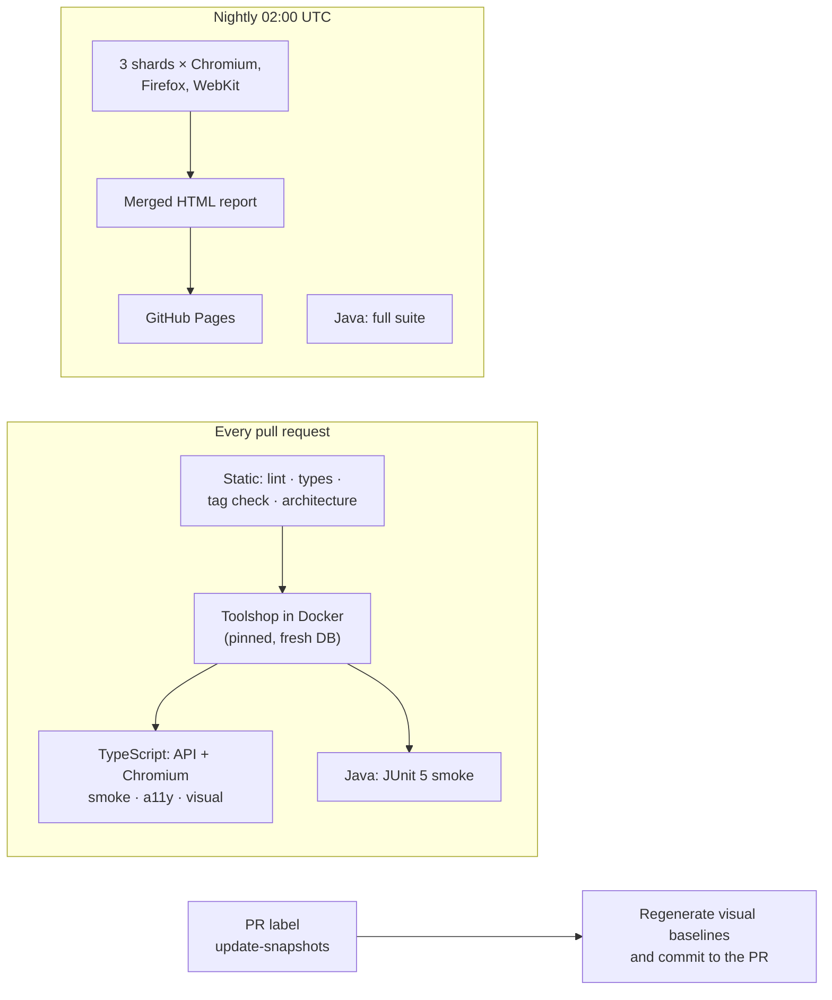

# Playwright E2E Showcase

[](https://github.com/junchunip-hue/playwright-e2e-showcase/actions/workflows/pr-smoke.yml)
[](https://github.com/junchunip-hue/playwright-e2e-showcase/actions/workflows/nightly-regression.yml)
· [Latest regression report](https://junchunip-hue.github.io/playwright-e2e-showcase/)

A test automation framework built the way I would set it up in a real team, with **Playwright + TypeScript**
(and a Java + JUnit 5 twin). It targets the open-source [Toolshop](https://practicesoftwaretesting.com) demo shop.

## The 3-minute tour

**1. A journey that reads like the story it tests:** [`tests/e2e/checkout.spec.ts`](tests/e2e/checkout.spec.ts)
```ts
const customer = await createCustomer(api);              // arrange via API: fresh data, no shared state
const product = await api.products.findInStock();

await checkout.addToCart(product);                       // act via UI: business steps from src/flows
const cartTotal = await checkout.reviewCart([product]);
await checkout.signIn(customer);
await checkout.confirmAddress(customer.address);
const invoiceNumber = await checkout.pay(payments.cashOnDelivery());
// assert via API: the invoice exists, for this customer, at the cart total
```

**2. Quality beyond "it works"**
- Every API response is checked against a schema ([`src/api/schemas.ts`](src/api/schemas.ts)).
- Accessibility (axe, WCAG 2.1 AA) and visual regression run in [`tests/quality/`](tests/quality/).
- The full suite runs nightly on Chromium, Firefox and WebKit.

**3. A pipeline that guards itself**
- Tags and suites live in one registry ([`src/tags.ts`](src/tags.ts)), and every test title carries its test-plan ID.
- [Architecture tests](tests/architecture/) fail if a workflow could trigger itself, a dependency loops, or a job could hang.

## How it runs



CI never uses the public demo: it boots its own Toolshop for every run, so results depend only on the code
([why](docs/ci.md#system-under-test)).

## Layout

```
src/
  api/          API client per resource + zod schemas (types derived from them)
  flows/        business steps for journeys (checkout, ...)
  pages/        page & component objects (locators only)
  data/         test data builders (fresh customers per test)
  fixtures/     everything above, injected into tests
  tags.ts       tag and suite registry
  a11y/ visual/ reporters/ config/
tests/
  api/          contract, auth and registration tests
  ui/           single-page behaviour (login, search, cart)
  e2e/          journeys across pages, API and UI
  quality/      accessibility and visual regression
  architecture/ rules about the pipeline and the code itself
java/           Playwright for Java + JUnit 5 twin of the smoke scenarios
.github/        workflows (PR, nightly, baselines) and shared actions
```

## Run it

```bash
npm install && npx playwright install && cp .env.example .env
npm run test:pr             # what the PR gate runs (API + Chromium)
npm run test:architecture   # pipeline/code rules, no browser
npm run check:tags          # tag counts; fails on unknown tags, missing tier or ID
npm test                    # everything
npm run report              # open the HTML report
```
Java: `cd java && ./mvnw test` (JDK 21+, see [docs/java.md](docs/java.md)).

## Read more

| Question | Document |
|---|---|
| Why is it built this way? | [docs/test-strategy.md](docs/test-strategy.md) |
| What runs, where, and which IDs exist? | [docs/test-plan.md](docs/test-plan.md) |
| How does the pipeline work and protect itself? | [docs/ci.md](docs/ci.md) |
| Which decisions were made, and why? | [docs/decisions/](docs/decisions/) |
| What comes next? | [docs/roadmap.md](docs/roadmap.md) |
| How does the Java twin stay in sync? | [docs/java.md](docs/java.md) |
