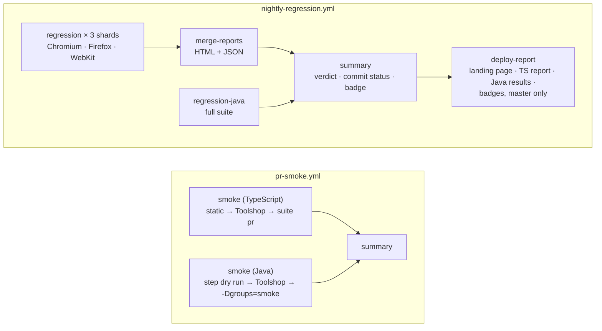

# CI – how the pipeline runs and protects itself

> Workflows: `.github/workflows/`. Shared steps: `.github/actions/`. Why it is set up this way: [decisions/](decisions/).

## System under test
CI never uses the public demo. Every job boots Toolshop in Docker from an upstream commit that is pinned in one
place, `.github/actions/toolshop-start` (version, sprint and URLs, exported to the job). The database is
migrated and seeded on every run, so results depend only on the code under test
([ADR 0001](decisions/0001-ci-runs-its-own-toolshop.md)).

`toolshop-ready` installs API dependencies, seeds the database and waits until a data endpoint (`/products`) and the
UI both return 200. A plain health endpoint was green while data endpoints still failed. It also starts Toolshop's
background jobs, which production runs from its scheduler: in rounds, `invoice:generate` (queues a PDF for every
invoice without one, needed by S5) and then three queue workers (PDFs, stock updates; e-mails fail quietly, there is
no mail server). The first round renders the 200 seeded invoices, which one worker needed 4-5 minutes for. `order:update` is left out: it changes order statuses by
itself and would race S3.

## Workflows
| Workflow | Trigger | What runs | Browsers |
|---|---|---|---|
| `pr-smoke.yml` | Every PR and push to `master` | **Static:** lint, format (Prettier), typecheck, `check:tags`, `check:steps`, `test:architecture` ([coding rules](coding-rules.md)) **Then:** suite `pr` (smoke + a11y + visual) on API + Chromium, and in parallel the Java lane: Spotless format check, a dry run that binds every feature's steps (seconds, no browser), then the Java smoke suite | Chromium |
| `nightly-regression.yml` | 02:00 UTC, manual, PRs that change it | Suite `nightly` (everything except the agents' seed) in 3 shards, plus the full Java suite | Chromium, Firefox, WebKit |
| `update-visual-baselines.yml` | PR label `update-snapshots` | Regenerates Linux baselines, verifies them with a second run, commits them to the PR, and comments how to get PR checks on that commit (GitHub runs no workflow for a push made by Actions) | Chromium |

**Dependency updates:** Dependabot (`.github/dependabot.yml`) opens one grouped PR per week for npm, Maven and GitHub
Actions, gated by the same PR checks. Major versions of npm and Maven packages stay manual, and so do Playwright minors: TypeScript and Java move
to the same minor in one PR, which an architecture test checks ([roadmap §6](roadmap.md#6-what-comes-next)).

The nightly's GitHub Pages site, built by the `summary` job because only it has both languages' results:
- `/` a **landing page** (`scripts/pages-site.mjs`, from the summary's data): the verdict, both lanes with their
  counts and links, TypeScript vs Java per test ID, failed tests with their failed and not-run steps, flaky tests and the
  nightly history. Both README
  badges open it.
- `/typescript/` the merged Playwright HTML report; `/java/` every Java scenario with its steps, from the Surefire
  XML and the scenario log.
- `badge.json`, which the "nightly tests" badge reads (shields.io endpoint): all test runs of both languages, coloured
  like the verdict (green passed, yellow passed with flaky, red failed); `streak.json` and `history.json` (below).
**Merging:** a ruleset on `master` makes the PR pipeline a real gate: every change goes through a pull request, and
`smoke (TypeScript)`, `smoke (Java)` and `test verdict / PR smoke` must pass before it merges (no bypass, also not for
admins). The nightly is not required: it runs after merge.

Every test job has its own Toolshop; every job has a timeout of at most 60 minutes. `summary` and `merge-reports` run even when a
lane fails (`!cancelled()`), so a red run still shows which IDs failed in which language.

Two infrastructure hiccups seen in six back-to-back nightlies (2026-11-18) are absorbed so they cannot turn a green
test run red or stall it:
- **Browser install:** `playwright install --with-deps` waits on the Ubuntu package mirror, which once took 29 minutes
  instead of one. [`scripts/install-browsers.sh`](../scripts/install-browsers.sh) gives each attempt 8 minutes and
  tries 3 times, each retry on another Ubuntu mirror (retrying the same slow mirror only crawled on). Between attempts
  it stops the leftover `apt-get` (it outlives the timeout and holds the dpkg lock); apt's download cache means a retry
  fetches only what is still missing. The packages themselves (140 MB of .deb files for three browsers, 22 MB for
  Chromium) are kept in the Actions cache by [`install-browsers`](../.github/actions/install-browsers/action.yml), keyed
  by Ubuntu release, browsers and Playwright version, so a normal run fetches nothing from the mirror and only the
  package index (4 MB, seconds) still comes from it. Every job, the Java lane included, installs browsers through that
  action (an architecture test enforces that).
- **Report merge:** artifact storage once failed one blob download even after the action's own retries, although the
  blob downloaded fine minutes later. `merge-reports` tries once more after a minute.

| Artifact | From | Contents |
|---|---|---|
| `playwright-report` / `regression-report` | PR / nightly | HTML report with traces, screenshots and video on failure |
| `ts-results` | PR, nightly | Playwright JSON, input for the summary |
| `junit-reports` / `junit-reports-nightly` | PR / nightly | Surefire XML, input for the summary |
| `junit-reports-traces` / `junit-reports-nightly-traces` | Java failure only | Playwright traces of the failed Java tests |
| `blob-report-<shard>` | nightly | Shard results, merged by `merge-reports` |

**Nightly mechanics:** each shard boots its own Toolshop (no shared data between shards) and writes a blob report.
A merge job turns the blobs into one HTML report, and runs on `master` publish it to GitHub Pages (`/typescript/`). The `setup` login
project only runs in shards that contain UI tests. A PR that changes the workflow runs it without publishing.

**Local runs** default to Chromium. Firefox and WebKit are opt-in (`ALL_BROWSERS=1`), because Playwright's Firefox
failed to start on the Windows 11 dev machine (SxS error, `mozglue`), and cross-browser coverage is a CI concern.

## Pipeline summary
Both workflows end with a `pipeline summary` job (`scripts/pipeline-summary.mjs`). It reads the Playwright JSON
results and the Surefire XML reports and writes the run page's job summary:
- a **verdict** on top, one of three:

  | Verdict | When | Shown as |
  |---|---|---|
  | ✅ Passed | no failed and no flaky test | green box |
  | ⚠️ Passed with N flaky tests | every test passed, but some only on a retry (both suites retry a failed test twice in CI and never locally: `retries` in `playwright.config.ts`, Surefire reruns in the `ci-retries` profile of `java/pom.xml`; an architecture test keeps the two equal) | gold box, gold result node with a green border |
  | ❌ Failed | any test failed, or a lane's job failed | red box |

  A flaky test does not fail the run, but it is never silent: each one is listed under **Flaky tests** with its ID,
  browser, file and line, its attempts (❌ → ✅, ⏱️ = timed out) and the first error, and it gets a warning annotation
  on the run page and in the PR's checks. The HTML report's Flaky tab has the traces of the failed attempts.

  The verdict is also posted as a **commit status** (`test verdict / PR smoke`, `test verdict / nightly`): a green
  check with "✅ Passed: no failed and no flaky tests", a green check with "✅ Passed · ⚠️ 2 flaky: S5 firefox, A7
  api", or a red cross with "❌ Failed: …". It shows next to the commit (commit list, branch list) and in the PR's
  checks, linked to the run. The Actions run list itself cannot show it: there GitHub draws only the run's own
  result (passed or failed) and a title fixed when the run starts.
- **What failed**, right under a red verdict: each failed job (linked), its failed step and the errors it reported
  (read from the run's jobs and their annotations by the "Collect failed jobs" step).
- **Not run is not passed.** The summary job lists the tests the run planned (`playwright test --list` for the same
  suite and projects) and marks every planned test without a result as ⛔ not run, per ID, in the diagram, the
  verdict, the commit status and the badge. A job that dies before its tests (e.g. a browser install) therefore turns
  its IDs ⛔, not ✅, and the run red. Java writes no results when its job dies early; it runs the same A/U/S IDs as
  TypeScript (ADR 0009), so those show ⛔ not run in the Java column.
- **A skip in CI counts as not run.** The only skips are for the public demo (`@admin` checks, S5), which CI never
  uses; a skip in CI means a test silently did not run (e.g. a wrong `BASE_URL`), so it turns the run red.
- **No list, no "Passed".** If the planned-test list cannot be made, the summary cannot see tests that never ran: the
  verdict is ⚠️ Unverified (yellow badge, status says so) instead of ✅ Passed.
- **A rerun is not a fresh pass.** "Re-run failed jobs" gives the run a new attempt, and its verdict replaces the
  commit status. So the summary keeps each earlier attempt's jobs: if one failed, a passing attempt says ⚠️ Passed on a
  rerun ("Passed on attempt 2 (attempt 1 failed: … at "Start Toolshop")"), the badge turns yellow and the run does
  not count as clean. A failed attempt stays failed in `history.json` (one entry per run, the first one wins).
- **Clean streak.** On `master`, the nightly adds its verdict to `history.json` on Pages (read back from there on the
  next run; `scripts/nightly-history-seed.json` holds the runs before it existed) and publishes `streak.json`, the
  README's "clean nightlies" badge: passed runs in a row, the stability criterion of roadmap §5.
- The Actions run list shows only each job's result: a run with a flaky test is ✅ there. The verdict is in the
  summary, the commit status and the badges.
- a **Mermaid diagram of the run**: the TypeScript and Java lanes with their counts; the setup nodes follow the job
  result, the result node the verdict above (so a nightly whose tests failed is red even though its report merge
  succeeded);
- a **table per test ID** with TypeScript and Java results side by side and whether the ID runs in both;
- a **Failed tests** table (when a test failed on every attempt): per test its ID, where it ran, the Gherkin step
  where it failed with the error, and each step after it, which did not run. TS reads the `failed step` and `not run`
  annotations that `src/steps/not-run.hooks.ts` adds; Java reads the steps from the scenario log (`scenarios.jsonl`
  next to the Surefire XML, written by `com.showcase.report.ScenarioLog`), where Cucumber marks the steps after a
  failure as skipped. Surefire's XML is not enough: with CI reruns on it drops the output of passed tests
  ([ADR 0013](decisions/0013-failures-stay-failures.md)).

Java reports carry display names (`U6: ...`, `S2: ... › gift-card`) via Surefire's phrased names, so both sides are
matched by test ID. Every A, U and S ID must appear in both columns: the parity architecture test (and the
tier check in `check:tags`) enforce that before any
test runs ([ADR 0009](decisions/0009-every-journey-in-both-languages.md)).

## Gherkin features
Scenarios moved to Gherkin (`features/`, [ADR 0012](decisions/0012-gherkin-features-with-layered-steps.md)) run in
both lanes. TypeScript: `npx bddgen` generates them into `tests/features/` before Playwright runs; the npm scripts
and `scripts/run-suite.mjs` do it themselves, and an architecture test makes every workflow step that calls
`playwright test` directly run `bddgen` first. Java: `com.showcase.RunCucumberTest` runs the same files with
Cucumber-JVM, inside the normal `mvnw test` (Cucumber tags are JUnit tags, so `-Dgroups=smoke` selects them).

## Tags and suites
- `src/tags.ts` defines every tag and suite. Specs use `Tag.*` (a typo is a compile error). CI and npm scripts pass
  only a suite name (`SUITE=pr`), and `playwright.config.ts` turns it into `grep`/`grepInvert`, adding `@setup`
  where a login is needed.
- **Tiers:** every test has exactly one of `@smoke` (PR gate), `@regression` (nightly), `@setup`, `@seed`.
  **Kinds** are optional: `@negative`, `@e2e`, `@a11y`, `@visual`, `@architecture`, and `@admin`. An `@admin` test signs in as
  the seeded admin or can change catalogue or orders, so it is skipped against the public demo (TS: `adminToken`
  fixture or `test.skip(isPublicDemo, ...)`, Java: `Hooks` `@Before("@admin")`) and runs against our own Toolshop only.
- **Failures:** a failing test stays a failure; there are no known-issue markers or expected failures
  ([ADR 0013](decisions/0013-failures-stay-failures.md)). Every report lists the failed step and the steps after it
  as not run.
- **Failure control (C1):** `features/control/failure-control.feature`, tier `@control`, fails on purpose every night
  so the reports show a real failure. Shard 1 runs it after the regression run (`SUITE=control`, own blob report,
  merged into the HTML report, project `control`) and the Java job runs it after the full suite (`-Dgroups=control -DexcludedGroups=`, own
  reports); both steps are `continue-on-error`. Every other suite and Maven run excludes it (`src/tags.ts`, `pom.xml`
  `excludedGroups`), and the summary shows it in its own "Failure control (not counted)" section, outside the verdict,
  the counts, the badge and the streak.
- **IDs:** every test title (except setup/seed) starts with an ID from [test-plan.md](test-plan.md), e.g. `U6: ...`.
- `npm run check:tags` lists all tests without a browser and prints the count per tag. It fails on unknown tags, a
  missing or duplicate tier, or a missing/unknown ID. Java runs the same feature files, so the check covers both.

## Visual baselines
Committed baselines are `*-chromium-linux.png` from the pinned, seeded Toolshop. To refresh them, add the
`update-snapshots` label to a PR. Commits pushed with `GITHUB_TOKEN` do not start new runs, so push any commit
afterwards to re-run the PR gate. The PNG diff in the PR is the review step
([ADR 0004](decisions/0004-visual-baselines-from-ci.md)).

## Architecture tests
`tests/architecture/` (project `architecture`, run in the static stage in about a second) fails when:
- a workflow that pushes commits could trigger itself: it must not run on `push`, `workflow_run` or
  `repository_dispatch`; it must keep `GITHUB_TOKEN`, remove its trigger label, and have a concurrency group
- `workflow_run` triggers form a cycle, or a step starts or re-runs a workflow
- composite actions, npm scripts, Playwright project dependencies or TypeScript imports form a cycle
- a job has no `timeout-minutes` ≤ 60, or a shell step uses `while`/`until` instead of a bounded `for … in $(seq …)`
- a step installs browsers with `playwright install` (npx or the Java CLI) instead of the bounded, cached
  `install-browsers` action
- an A/U/S ID exists in only one language, or the test plan's "Java" column disagrees with `java/` (parity)

See [ADR 0008](decisions/0008-architecture-tests.md) for what they found on their first run.
