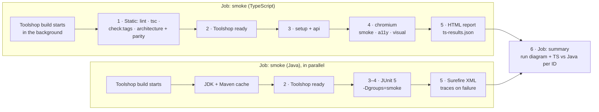

# Test Plan – inventory, order, environments

> Companion to [`test-strategy.md`](test-strategy.md). The strategy explains *why*; this file lists *what* runs,
> *in which order*, *where*, and what is still to be built.

## 1. Environments

| Environment | Where | System under test | Browsers | Used for |
|---|---|---|---|---|
| **Local dev** | Developer machine (Windows 11) | Public demo `practicesoftwaretesting.com` (or local Docker via `.env`) | Chromium (Firefox/WebKit opt-in `ALL_BROWSERS=1`) | Writing and debugging tests |
| **CI – PR / main** | GitHub Actions, `ubuntu-latest` | Toolshop in Docker, upstream commit pinned in `.github/actions/toolshop-start`, DB seeded per run (`localhost:4200` / `:8091`) | Chromium | Gate every PR and push: `@smoke`, `@a11y`, `@visual` (TS) + `smoke` (Java) |
| **CI – Nightly** | GitHub Actions, 02:00 UTC + manual | Same Docker setup, one instance per shard | Chromium, Firefox, WebKit | Full suite (TS, 3 shards) + full Java suite; merged report on GitHub Pages |
| **CI – Visual baselines** | GitHub Actions, PR label `update-snapshots` | Same Docker setup | Chromium | Regenerates Linux baselines and commits them to the PR |

Why CI never uses the public demo: Cloudflare serves a bot challenge to CI runner IPs ([ADR 0001](decisions/0001-ci-runs-its-own-toolshop.md)).

## 2. Pipeline order (one PR run)

Stages of the TypeScript lane:

| # | Stage | Checks | Fails fast because |
|---|---|---|---|
| 1 | Static (TypeScript job, while Toolshop builds) | ESLint (incl. Playwright rules), `tsc --noEmit`, tag check, architecture tests | Broken code or a looping pipeline never reaches a browser |
| 2 | Environment | Containers up, DB seeded, `/products` and UI return 200 | Infra problems are reported as infra, not as test failures |
| 3 | `setup` + `api` (parallel) | Session for UI tests; API contract checks | Cheapest layer first |
| 4 | `chromium` | UI smoke incl. checkout E2E, accessibility, visual (depends on `setup`) | Only runs when login works |
| 5 | Report | HTML report + trace/video on failure, uploaded as artifact | Every failure is debuggable without re-running |

The Java lane runs the same stages 2–5 in parallel with JUnit 5 (`./mvnw test -Dgroups=smoke`), and the summary job
(stage 6) runs after both, whatever their result. Nightly runs the same shape with every tier: see [ci.md](ci.md#workflows).

## 3. Test inventory

### How IDs work
| Prefix | Layer | Where |
|---|---|---|
| **A** | API: contracts, rules, permissions | `tests/api` |
| **U** | UI: one page or one widget | `tests/ui` (U6, the first journey, sits in `tests/e2e`) |
| **S** | Story: a journey across pages, roles or layers | `tests/e2e` |
| **N** | Non-functional: visual, accessibility, architecture | `tests/quality`, `tests/architecture` |

- **A number is given when an item enters this plan**, as the next free number of its prefix, whether or not it
  is built yet. So the order of the numbers is the order things were planned, not the order they were built
  (S6 was built before S4) or their priority.
- **IDs are stable:** never renumbered, reused or filled in, so links, reports and commit messages keep pointing at
  the same test. A number without a test is an item that was planned but not built: backlog (U9–U11) or optional
  (S7), each with its row and status below. A6, A7 and S5 were such items until 2026-11-19.
- **The next new item** gets the next number after the highest one: A12, U12, S8, N4.
- **A0** is the contract guard that applies to every API response, so it comes before the numbered API checks.
- **Aliases:** U6 is also S1 (the first journey). U7 and U8 were planned as UI tests and became journeys S2 and S4;
  they keep their row so old references still resolve.
- One ID can have several test cases (e.g. A4: weak and leaked password). Every title starts with its ID, which
  `check:tags` and the Java `TagGuardTest` enforce.

**Status:** ✅ done · ↪ done under another ID · ⬜ optional · ➖ backlog, not planned
([roadmap §5](roadmap.md#5-definition-of-done)). **Java ✅** marks scenarios mirrored in `java/` (JUnit 5).

| Layer | Done | Optional | Backlog |
|---|---|---|---|
| API | A0–A11 | – | – |
| UI | U1–U6 (U7 ↪ S2, U8 ↪ S4) | – | U9–U11 |
| Journeys | S1 (= U6), S2–S6 | S7 | – |
| Non-functional | N1–N3 | – | – |

### API (`tests/api`, project `api`, no browser)
| ID | Test | Tag | Java | Status |
|---|---|---|---|---|
| A0 | Response contracts: every response validated against `src/api/schemas.ts` (zod); explicit checks for list/detail/search, empty paginator, login + invoices, postcode lookup, and the guard itself | `@smoke` | ✅ | ✅ |
| A1 | `GET /products` is paginated and well-formed | `@smoke` | ✅ | ✅ |
| A2 | Valid credentials return a token | `@smoke` | ✅ | ✅ |
| A3 | Wrong password → 401 | `@regression @negative` | ✅ | ✅ |
| A4 | Register: weak password → 422 listing every unmet rule | `@smoke @negative` | ✅ | ✅ |
| A4 | Register: password from a data leak → 422 (external HIBP check, so nightly) | `@regression @negative` | ✅ | ✅ |
| A5 | Register: duplicate email → **409** Conflict (not 422 as first assumed) | `@smoke @negative` | ✅ | ✅ |
| A6 | Invoices need a signed-in user: list, detail, PDF and PDF status answer 401 without a token (and 200/404/400 with one, so the 401 is about the token, not the id); a malformed token is refused the same way | `@smoke @negative` (malformed: `@regression`) | ✅ | ✅ |
| A7 | Product filters: category, brand, inclusive price range, sort by price or name across pages, and all combined; every product in the result matches | `@regression` | ✅ | ✅ |
| A8 | Admin publishes a product: listed with its brand/category, searchable, in stock (own Toolshop only) | `@smoke @admin` | ✅ | ✅ |
| A9 | Payment check: every method with valid details → 200; invalid card → 422 naming only the broken field | `@smoke @negative` | ✅ | ✅ |
| A10 | A customer cannot publish a product: intended 403, **known defect** today 201 ([ADR 0010](decisions/0010-known-defects-as-tests.md); own Toolshop only) | `@smoke @negative @admin` | ✅ | ✅ |
| A11 | A customer cannot change the status of another customer's order: intended 403, **known defect** today 200; sends the current status, so nothing changes (own Toolshop only) | `@smoke @negative @admin` | ✅ | ✅ |

### UI and journeys (`tests/ui`, `tests/e2e`, project `chromium`; Firefox/WebKit nightly)
| ID | Test | Tag | Java | Status |
|---|---|---|---|---|
| U1 | Login with valid credentials | `@smoke` | ✅ | ✅ |
| U2 | Login error for wrong password | `@smoke @negative` | ✅ | ✅ |
| U3 | Search: every result matches the term | `@smoke` | ✅ | ✅ |
| U4 | Search: UI results equal search API results | `@regression` | ✅ | ✅ |
| U5 | Add to cart updates the badge (product picked via API) | `@smoke` | ✅ | ✅ |
| **U6** | **Checkout E2E: API-registered customer → cart → sign in → saved address (filled in and looked up by the app) → cash on delivery → invoice verified via API** | `@smoke @e2e` | ✅ | ✅ |
| U7 | Checkout with each payment method → built as journey **S2** | – | | ↪ S2 |
| U8 | Guest checkout → built as journey **S4** | – | | ↪ S4 |
| U9 | Cart: change quantity / remove item, totals update | `@regression` | | ➖ |
| U10 | Registration form validation (UI) | `@regression` | | ➖ |
| U11 | Category filter + sort on the catalogue | `@regression` | | ➖ |

### Journeys (`tests/e2e`, see [roadmap.md](roadmap.md) §2)
| ID | Journey | Tag | Java | Status |
|---|---|---|---|---|
| S1 | First purchase: the same test as U6 | `@smoke @e2e` | = U6 | ✅ |
| S2 | Payment matrix: bank transfer, credit card, buy now pay later, gift card each end in an invoice at the cart total; a malformed or expired card is flagged in the form, cannot be submitted, is rejected by the API too, and creates no invoice | `@regression @e2e` | ✅ | ✅ |
| S3 | Admin publishes a product (API), customer finds and buys it (UI), admin ships it (API), customer sees it listed and SHIPPED (own Toolshop only) | `@regression @e2e @admin` | ✅ | ✅ |
| S4 | Guest checkout: a never-registered guest buys through the guest tab (email and name), the postcode lookup fills the address, the order goes to `POST /invoices/guest`; the admin finds it at the cart total with the guest's billing address (own Toolshop only) | `@regression @e2e @admin` | ✅ | ✅ |
| S5 | Returning customer: signs in first, saves a favourite, compares two products (prices as in the catalogue), buys the cheaper one while signed in, downloads the invoice PDF once the background job has written it (`<number>.pdf`, a real PDF); the API has the favourite, the order and PDF status COMPLETED (own Toolshop only) | `@regression @e2e` | ✅ | ✅ |
| S6 | Resilience with network mocking (`page.route`): a 3 s slower catalogue still shows its products; a failed catalogue (500) shows no products, and a reload recovers; a failed search (500) is shown as "no results", and the next search works | `@regression` (+ `@negative`) | ✅ | ✅ |
| S7 | Languages: key pages translated, a11y and visual still pass ([roadmap §2](roadmap.md#2-showcase-scenarios-longer-journeys)) | – | | ⬜ |

**Findings while building S3 (pinned source), tracked as known defects by A10 and A11:**
- `POST /products` checks no role: `StoreProduct::authorize()` returns true, and `ProductController` requires the
  admin role for `destroy` only.
- `PUT /invoices/{id}/status` only requires a signed-in user: `InvoiceService::updateInvoiceStatus` updates by ID
  without a role or owner check, so any customer can change any order.

S3 tests the intended flow (an admin acts). A10 and A11 assert the intended rule through `expectKnownDefect` /
`KnownDefect` ([ADR 0010](decisions/0010-known-defects-as-tests.md)): they pass while the API answers exactly as
today, and fail once it is fixed, so the marker is then replaced by a plain assertion.

**Finding while building S4 (pinned source, not asserted):** a guest's email and name are not stored with the
order. `POST /invoices/guest` validates them, but `Invoice::$fillable` has no guest fields, so they only reach the
confirmation-email job. The saved invoice has `user_id: null` and a billing address, and nothing to contact the
customer with. S4 checks what is stored (total, billing address).

**Finding while building S5 (environment):** Toolshop writes invoice PDFs from its scheduler
(`invoice:generate`, then a queue worker), which a plain `docker compose up` does not run, so the download button
stays disabled for ever. CI now runs both commands in the background (`toolshop-ready`), with three workers: the
first round renders the 200 seeded invoices before any new order, which delayed S5 by 4-5 minutes with one worker.
The public demo starts the job but did not finish a PDF within 4 minutes (measured 2026-11-19), so S5 runs against
our own Toolshop only. A customer who signs in before checkout gets the saved address filled in and looked up as soon
as the address step opens, at a moment that differs per browser; typing the same values again triggers no new
lookup. S5 therefore checks the saved address instead of waiting for a lookup request.

**Finding from the nightly of 2026-11-19 (test, fixed):** S2 credit-card was flaky on Firefox. The app fills a
signed-in customer's saved address in (`GET /users/me`) while the test was typing the same address: `fill` had
selected the postcode, the saved `90210` landed, and the typed `90210` was appended, so the app looked up
`9021090210` and got a 422 ("format is not valid for the selected country"). Since then every signed-in journey
(U6, S2, S3, S5) checks the saved address the app filled in and looked up, and types nothing; typing an address
into the lookup form is covered by S4, the guest, whose form starts empty. The first sign was the new flaky list in
the pipeline summary.

**Findings while building S6 (pinned UI source, UX, pinned by S6):** the catalogue page has no error state.
`OverviewComponent.getProducts()` subscribes without an error handler, so a failed `GET /products` leaves the page
blank without a message. The search's error handler replaces the results with an empty page, so a server error is
shown as "There are no products found". A customer cannot tell an outage from an empty result. S6 pins both and
checks recovery; a future error message would fail S6 on purpose, which is the moment to assert the message instead.

### Non-functional (`tests/quality`, `tests/architecture`; Chromium only)
| ID | Test | Where | Status |
|---|---|---|---|
| N1 | Visual regression: header, login form, contact form, catalogue filters, full login page (masked) | PR + nightly | ✅ |
| N2 | Accessibility: axe-core WCAG 2.1 A/AA on 6 pages, known-issue baseline ([ADR 0003](decisions/0003-accessibility-known-issues.md)) | PR + nightly | ✅ |
| N3 | Architecture: no self-triggering workflows, no cycles (actions, workflow_run, npm scripts, projects, imports), every job and browser install bounded; TS/Java parity with this plan | PR static stage | ✅ |

### Where each ID runs (today)
| ID | Tests | Tier | PR gate | Nightly | Browsers | Java class |
|---|---|---|---|---|---|---|
| A0 | 5 | smoke | ✅ | ✅ | API | `ContractsApiTest` |
| A1, A2 | 1 + 1 | smoke | ✅ | ✅ | API | `ApiTest` |
| A3 | 1 | regression | – | ✅ | API | `ApiTest` |
| A4 | 2 | smoke (weak) + regression (leaked) | weak only | ✅ | API | `RegistrationApiTest` |
| A5 | 1 | smoke | ✅ | ✅ | API | `RegistrationApiTest` |
| A6 | 2 | smoke (no token) + regression (malformed) | no token | ✅ | API | `InvoicesApiTest` |
| A7 | 7 | regression | – | ✅ | API | `ProductFiltersApiTest` |
| A8 | 1 | smoke, admin | ✅ | ✅ | API | `AdminApiTest` |
| A9 | 2 | smoke | ✅ | ✅ | API | `PaymentApiTest` |
| A10, A11 | 1 + 1 | smoke, admin (known defects) | ✅ | ✅ | API | `PermissionsApiTest` |
| U1, U2, U3, U5 | 1 each | smoke | ✅ | ✅ | Chromium; nightly + Firefox, WebKit | `LoginTest`, `SearchTest`, `CartTest` |
| U4 | 1 | regression | – | ✅ | Chromium, Firefox, WebKit | `SearchTest` |
| U6 (S1) | 1 | smoke, e2e | ✅ | ✅ | Chromium; nightly + Firefox, WebKit | `CheckoutJourneyTest` |
| S2 | 6 | regression, e2e | – | ✅ | Chromium, Firefox, WebKit | `PaymentJourneyTest` |
| S3 | 1 | regression, e2e, admin | – | ✅ | Chromium, Firefox, WebKit | `AdminToCustomerJourneyTest` |
| S4 | 1 | regression, e2e, admin | – | ✅ | Chromium, Firefox, WebKit | `GuestCheckoutJourneyTest` |
| S5 | 1 | regression, e2e (own Toolshop only) | – | ✅ | Chromium, Firefox, WebKit | `ReturningCustomerJourneyTest` |
| S6 | 3 | regression | – | ✅ | Chromium, Firefox, WebKit | `ResilienceTest` |
| N1 | 5 | regression, visual | ✅ (`@visual`) | ✅ | Chromium | TypeScript only |
| N2 | 6 | regression, a11y | ✅ (`@a11y`) | ✅ | Chromium | TypeScript only |
| N3 | 14 | smoke, architecture | static stage | ✅ | none | TypeScript only |

"Tests" counts TypeScript test cases per ID (68 in total; data-driven cases count once each). The Java class
covers the same ID with the same tier. `@admin` tests run only against our own Toolshop, never the public demo.

`tests/ui/seed.spec.ts` (`@seed`) is the starting state for Playwright Test Agents, not a test case: no suite
selects it.

Tags and suites are defined in `src/tags.ts` (Java: `com.showcase.annotations`); see [ci.md](ci.md#tags-and-suites).
Every test has exactly one tier tag, enforced by `npm run check:tags` and the Java `TagGuardTest`.

## 4. Which platform checks what

| Check | Local | CI PR/main | CI Nightly |
|---|---|---|---|
| Lint + typecheck | ✅ (`npm run lint`, `npm run typecheck`) | ✅ | – |
| API tests | ✅ | `@smoke` | all |
| UI – Chromium | ✅ | `@smoke` | all |
| UI – Firefox / WebKit | opt-in | – | all (except `@a11y`, `@visual`) |
| Checkout E2E | ✅* | ✅ | ✅ (all browsers) |
| Accessibility | ✅ (`npm run test:a11y`) | ✅ | ✅ |
| Visual regression | own OS baselines, git-ignored | ✅ (Linux baselines) | ✅ |
| Java suite | ✅ (`./mvnw test`) | `smoke` | all |
| Report | local HTML | artifact (14 days) | GitHub Pages |

\* Locally against the public demo, U6 registers a new demo account per run; prefer a local Docker instance.

## 5. Roadmap

| Step | Scope | Shows |
|---|---|---|
| ✅ | Framework, POM, fixtures, smoke suite, PR CI | Structure, conventions |
| ✅ | Toolshop in Docker in CI | Environment isolation, CI debugging |
| ✅ | Checkout E2E with API-created customer (U6) | Test data design, hybrid API/UI |
| ✅ | Java + JUnit 5 twin suite for the smoke scenarios | Same design in two stacks |
| ✅ | Nightly: 3 browsers, sharding, merged blob report on GitHub Pages | CI scalability |
| ✅ | N1 visual regression, N2 axe-core | Quality beyond functional |
| ✅ | A0 API schema validation (types derived from the schemas) | Contract testing |
| ✅ | Negative login tests on throwaway accounts (the shared demo account locks after repeated failures) | Test data isolation |
| ✅ | A4, A5 registration rules; N3 architecture tests | Negative testing, self-guarding pipeline |
| ✅ | Structure R1–R6: test folders by intent, flows, per-resource API client, IDs in titles, docs by question | Readable at scale |
| ✅ | S2 payment matrix, S3 admin → customer → admin (A8, A9) | Data-driven and cross-role journeys |
| ✅ | Every A/U/S scenario in Java with the same tier; parity architecture test; TS vs Java pipeline summary | Two stacks, one plan |
| ✅ | A10/A11 permission negatives as tracked known defects | Security findings turned into tests |
| ✅ | S6 resilience with network mocking: slow and failing catalogue, failing search, recovery | Network mocking, failure UX |
| ✅ | S4 guest checkout: second entry into checkout, guest invoice checked as admin | Every demo technique shown once |
| ✅ | Seven clean nightlies in a row; CI hardened (bounded browser install, report-merge retry); README tour checked | Showcase done ([roadmap §5](roadmap.md#5-definition-of-done)) |
| ✅ | Numbering gaps filled: A6 invoice authentication, A7 product filters, S5 returning customer with PDF download; CI runs Toolshop's background jobs | Every planned A and S item built; downloads and waiting on background work |
